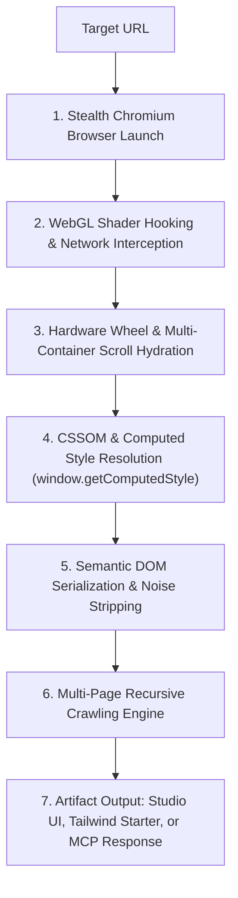

# ⚡ StealThisStack (`steal-this-stack`)

[](https://www.npmjs.com/package/steal-this-stack)
[](https://opensource.org/licenses/MIT)
[](https://nodejs.org/)
[](https://playwright.dev/)
[](https://modelcontextprotocol.io/)

> **Live DOM, Multi-Page Crawler & Computed CSS Reverse-Engineering Engine for AI Coding Agents and Developers.**  
> Extract exact computed CSS tokens, typography hierarchies, `@keyframes` animation curves, WebGL shaders, 3D meshes, vector SVGs, and interactive multi-page UI blueprints from any live website. Transform them instantly into a ready-to-run Tailwind starter repo or pipe them directly into **Claude Code**, **Cursor**, **Antigravity**, and **Gemini** via MCP.

---

## 📑 Table of Contents

- [⚡ Why StealThisStack?](#-why-stealthisstack)
- [⚔️ How StealThisStack Differs from Claude and Cursor](#-how-stealthisstack-differs-from-claude-and-cursor)
  - [The Core Dilemma: Why AI Agents Fail at Cloning Live Web Apps](#the-core-dilemma-why-ai-agents-fail-at-cloning-live-web-apps)
  - [Feature Comparison Matrix](#feature-comparison-matrix)
  - [Synergy: StealThisStack as the "Eyes" for Claude and Cursor](#synergy-stealthisstack-as-the-eyes-for-claude-and-cursor)
- [🧠 How It Works (Under the Hood Architecture)](#-how-it-works-under-the-hood-architecture)
- [📦 Installation Guide](#-installation-guide)
  - [Prerequisites](#prerequisites)
  - [Method 1: Zero-Install via `npx` (Recommended)](#method-1-zero-install-via-npx-recommended)
  - [Method 2: Global CLI Installation](#method-2-global-cli-installation)
  - [Method 3: Local Clone / Development](#method-3-local-clone--development)
  - [Essential: Playwright Chromium Browser Setup](#essential-playwright-chromium-browser-setup)
  - [Troubleshooting Installation](#troubleshooting-installation)
- [🚀 Usage Modes & Workflows](#-usage-modes--workflows)
  - [Mode 1: Automated Design System & Tailwind Starter](#mode-1-automated-design-system--tailwind-starter)
  - [Mode 2: Interactive Click-to-Steal Component Picker (`--pick`)](#mode-2-interactive-click-to-steal-component-picker---pick)
  - [Mode 3: Multi-Page Recursive Crawling (`--crawl <n>`)](#mode-3-multi-page-recursive-crawling---crawl-n)
  - [Mode 4: Native Model Context Protocol (MCP) Server (`--mcp`)](#mode-4-native-model-context-protocol-mcp-server---mcp)
- [🖥️ Replication Studio & Multi-Agent Prompt Hub](#-replication-studio--multi-agent-prompt-hub)
- [🤖 MCP Configuration Guide](#-mcp-configuration-guide)
  - [Cursor Configuration](#cursor-cursor-mcpjson)
  - [Claude Desktop / Claude Code Configuration](#claude-desktop--claude-code-claude_desktop_configjson)
  - [Antigravity Configuration](#antigravity-mcp_configjson)
- [📁 Output Project Structure](#-output-project-structure)
- [🛠️ CLI Reference](#-cli-reference)
- [📄 License](#-license)

---

## ⚡ Why StealThisStack?

Modern web interfaces are masterpieces of engineering: bespoke cubic-bezier transitions, fluid `clamp()` typography, layered box-shadows, CSS-in-JS design tokens, dynamic canvas shaders, and micro-interactions.

However, copying or reproducing these components today is painful:
1. **Developer Tools are tedious:** Manually inspecting elements, tracing 50 inheritance layers in CSSOM, finding `:root` variables, downloading embedded SVGs, and transcribing animation timings takes hours per component.
2. **AI Web Scrapers fail completely:** Passing a URL to ChatGPT, Claude, or Cursor yields either an HTTP 403 Forbidden error, an unstyled skeleton HTML, or completely fabricated Tailwind classes that do not match the real site.
3. **Screenshots lack mathematical truth:** Multimodal vision models hallucinate font weights, blur out small icon geometry, cannot read timing functions, and have no visibility into DOM hierarchy or hidden states.

**StealThisStack solves this fundamentally.** It spins up a real, stealth-instrumented Chromium engine on your local machine, renders the page, executes all JavaScript, hydrates lazy containers with hardware mouse scrolls, hooks into WebGL contexts, and extracts **100% ground-truth computed design tokens, assets, and serialized DOM blueprints**.

---

## ⚔️ How StealThisStack Differs from Claude and Cursor

When developers first hear about `steal-this-stack`, they often ask:  
> *"Claude 3.7 / Opus and Cursor already have web browsing tools and multimodal vision. Why can't I just paste a link or a screenshot into Claude or Cursor?"*

Here is the exact technical difference between relying solely on Claude or Cursor versus supercharging them with `steal-this-stack`:

### The Core Dilemma: Why AI Agents Fail at Cloning Live Web Apps

#### 1. Raw Web Fetchers vs. Real Computed Styles
* **Claude / Cursor (`@web` or curl/fetch):** When Claude or Cursor fetches a URL, it typically performs a lightweight server-side HTTP request (`fetch` / `curl` / Jina / readability scraper) and converts HTML to markdown or stripped text.
* **The Problem:** Modern sites are built with Next.js, React, Tailwind, styled-components, or Emotion. Styles are either compiled into obfuscated atomic hashes (e.g., `class="css-1m4j8x"` or `class="tw-83n"`) or injected at runtime via CSS-in-JS. The raw HTML contains **zero CSS rule definitions**. Claude and Cursor see the class names, but have **no idea what CSS properties those classes actually compute to**.
* **StealThisStack's Solution:** It runs a real browser instance and queries `window.getComputedStyle(element)`. It extracts the actual rendered values: `#0F172A`, `15px`, `font-weight: 600`, `letter-spacing: -0.02em`, `box-shadow: 0 20px 50px rgba(0,0,0,0.9)`, and inlines them directly into a structured blueprint.

#### 2. Screenshot "Vision" Hallucination vs. Mathematical Precision
* **Claude / Cursor (Vision):** You take a screenshot and ask Cursor or Claude: *"Recreate this card in Tailwind."*
* **The Problem:** Vision models can only guess. They guess `#3B82F6` when the brand color is `#2563EB`; they guess `rounded-lg` (8px) when the brand uses `14px`; they cannot see `backdrop-filter: blur(16px)`; they cannot measure line-height; and they cannot reproduce complex SVG paths or cubic-bezier physics (`cubic-bezier(0.16, 1, 0.3, 1)`).
* **StealThisStack's Solution:** It captures mathematically exact CSSOM declarations, CSS `@keyframes`, SVG paths, and exact viewport dimensions—eliminating visual guesswork entirely.

#### 3. Bot Protection & Cloudflare WAF Firewalls
* **Claude / Cursor:** Automated cloud-based IP fetchers are blocked by Cloudflare, Akamai, Datadome, and AWS WAF (returning 403 Forbidden, 429 Rate Limits, or Cloudflare Turnstile CAPTCHA pages).
* **StealThisStack's Solution:** It runs **locally on your machine** utilizing `playwright-extra` and `puppeteer-extra-plugin-stealth`. It disguises automation flags (`navigator.webdriver = false`, genuine viewport, real user agent, audio/WebGL fingerprints), effortlessly bypassing standard bot walls.

#### 4. WebGL Shaders, 3D Meshes, and Web Fonts
* **Claude / Cursor:** Neither Claude nor Cursor can inspect or download WebGL shaders, `.glb` 3D files, or custom `.woff2` font files from a live URL.
* **StealThisStack's Solution:** It patches `WebGLRenderingContext` and `WebGL2RenderingContext.prototype.shaderSource` at initialization, saving vertex and fragment shaders directly to local files, and intercepts network responses to download `.glb`, `.gltf`, `.splinecode`, and `.woff2` font files.

---

### Feature Comparison Matrix

| Capability | Claude Code / Claude Desktop | Cursor (Composer / @web) | StealThisStack Engine |
| :--- | :---: | :---: | :---: |
| **Execution Environment** | Cloud API / Headless fetch | Electron / Lightweight fetch | Local Stealth Playwright Chromium |
| **Bypasses Cloudflare / Anti-Bot** | ❌ Blocked (403 / Captcha) | ❌ Blocked on protected sites | ✅ Stealth plugin evasions |
| **Client-Side Hydration (SPA / React)** | ❌ Only sees SSR skeleton | ❌ Misses client-rendered DOM | ✅ Waits for JS load + dynamic state |
| **CSS Token Extraction (`:root`)** | ❌ Cannot access CSSOM | ❌ Cannot access CSSOM | ✅ Extracts full `:root` variable map |
| **Exact Computed CSS Resolution** | ❌ (Guesses based on classnames) | ❌ (Guesses based on classnames) | ✅ Exact `window.getComputedStyle` |
| **Lazy-Load Hydration** | ❌ None | ❌ None | ✅ 18-step hardware mouse scroll |
| **Animation Curves & `@keyframes`** | ❌ Missing | ❌ Missing | ✅ Extracts active `@keyframes` rules |
| **Interactive Visual Element Picker** | ❌ No browser UI | ❌ No browser UI | ✅ Visual highlight overlay + `↑`/`↓` keys |
| **Multi-Page Recursive Crawler** | ❌ Single URL fetch | ❌ Single URL fetch | ✅ Automated internal link queue (`--crawl`) |
| **WebGL & 3D Asset Interception** | ❌ Cannot hook canvas | ❌ Cannot hook canvas | ✅ Captures shaders + `.glb`/`.splinecode` |
| **Tailwind Starter Generation** | ❌ Raw code generation | ❌ Raw code generation | ✅ Pre-configured `tailwind.config.js` |
| **Native MCP Server Support** | Consumer of MCP | Consumer of MCP | ✅ **Direct MCP Provider (`--mcp`)** |

---

### Synergy: StealThisStack as the "Eyes" for Claude and Cursor

> **Important:** StealThisStack is not designed to replace Claude or Cursor—**it is the ultimate reverse-engineering engine built specifically to feed them.**

By running `steal-this-stack` as an **MCP server** or using its **Studio Prompt Hub**, you turn Claude and Cursor from blind guessers into surgical UI replicators:

```
┌─────────────────────────┐
│     Live Website        │  (Next.js, Tailwind, WebGL, 3D, CSS-in-JS)
└────────────┬────────────┘
             │
             ▼
┌─────────────────────────┐
│   ⚡ STEAL-THIS-STACK   │  (Stealth Playwright, CSSOM Resolver, Asset Interceptor)
└────────────┬────────────┘
             │ Ground-Truth Tokens, Clean DOM Blueprint & Assets
             ▼
┌────────────────────────────────────────────────────────┐
│     AI Coding Agents (Claude Code / Cursor / AGY)      │
│   "Rebuild this navbar using the extracted blueprint"  │
└────────────────────────────┬───────────────────────────┘
                             │
                             ▼
              1:1 Pixel-Perfect Production Code
```

---

## 🧠 How It Works (Under the Hood Architecture)

StealThisStack operates through a robust 7-stage reverse-engineering pipeline:



### 1. Stealth Browser Launch & Evasion
Launches Chromium with `puppeteer-extra-plugin-stealth` and customized flags (`--disable-blink-features=AutomationControlled`, realistic desktop viewport 1440×900, authentic user-agent strings). This prevents anti-bot scripts from detecting automation.

### 2. Runtime WebGL & Network Interception
Before any website script runs, `page.addInitScript()` patches:
- `WebGLRenderingContext.prototype.shaderSource`
- `WebGL2RenderingContext.prototype.shaderSource`

Whenever the page compiles a shader, StealThisStack intercepts the GLSL vertex and fragment source code. Simultaneously, network response listeners intercept binary `.glb`, `.gltf`, `.splinecode`, `.hdr`, and `.woff2` font files, writing them to `./stolen-stack/assets/`.

### 3. Hardware-Simulated Scroll Hydration
Modern web applications delay rendering below-the-fold content until triggered by scroll events or `IntersectionObserver`. StealThisStack performs an 18-step simulated hardware mouse scroll (`page.mouse.wheel`), triggering inner scroll containers (`[data-scroll-container]`, `<main>`), lazy images, and dynamic hydration, then resets smoothly back to top.

### 4. True Ground-Truth Computed Style Resolution
Unlike static HTML parsers, StealThisStack queries the live browser DOM tree and computes exact values:
- Traverses all document stylesheets (`document.styleSheets`) and extracts `:root` CSS variables.
- Queries computed styles on active elements to detect background colors, typography, line-heights, letter-spacings, border-radii, and multi-layered box-shadows.
- Extracts active CSS `@keyframes` animations and fluid layout rules (`clamp()`, CSS grid columns).

### 5. Semantic DOM Blueprint Serialization
Traverses the target element hierarchy and builds a clean, LLM-optimized markup:
- Strips unneeded framework scripts, tracking pixels, ad iframes, and accessibility overlays.
- Converts relative `src` and `href` links into absolute URLs.
- Inlines critical layout and typography tokens into concise `data-computed="..."` attributes.
- Preserves global SVG definitions (`<svg><defs>...</defs></svg>`) so vector icons never render broken.

### 6. Recursive Multi-Page Crawler
When run with `--crawl <number>`, the engine automatically collects same-origin internal hyperlinks, ignores media and asset downloads, manages a visited queue, and recursively extracts blueprints for subpages.

### 7. Studio & Starter Project Generation
Writes either:
- **Replication Studio (`picked-component.html`):** An interactive responsive workspace with mobile/tablet/desktop toggles, sandboxed `isolated-stage.html`, and one-click prompt presets for Claude, Cursor, Antigravity, and Gemini.
- **Tailwind Starter:** `tailwind.config.js` with mapped brand colors, fonts, border-radii, and shadows, plus a live showcase in `index.html`.
- **MCP Payload:** Structured JSON returned over standard I/O for AI tool calls.

---

## 📦 Installation Guide

### Prerequisites

Ensure you have the following installed on your machine:
- **Node.js:** v18.0.0 or higher ([Download Node.js](https://nodejs.org/))
- **npm** (bundled with Node) or **pnpm** / **yarn**
- **Operating System:** macOS, Windows (PowerShell / CMD / WSL), or Linux

---

### Method 1: Zero-Install via `npx` (Recommended)

You can run `steal-this-stack` directly without installing it globally:

```bash
# Reverse-engineer an entire page into a Tailwind starter:
npx steal-this-stack https://linear.app -o ./stolen-stack

# Launch the visual click-to-steal picker:
npx steal-this-stack https://stripe.com --pick

# Crawl 5 pages of a website:
npx steal-this-stack https://fiverr.com --crawl 5
```

---

### Method 2: Global CLI Installation

Install globally to make the `steal-this-stack` command available anywhere in your terminal:

```bash
npm install -g steal-this-stack
```

Verify your installation:
```bash
steal-this-stack --help
```

---

### Method 3: Local Clone / Development

If you want to contribute, modify the code, or run from source:

```bash
# 1. Clone the repository
git clone https://github.com/Shantanu12-byte/Steal-this-stack.git
cd Steal-this-stack

# 2. Install dependencies
npm install

# 3. Test running the CLI locally
node ./bin/cli.js --help
```

---

### Essential: Playwright Chromium Browser Setup

`steal-this-stack` uses Playwright to drive headless Chromium. On your first time using Playwright or if you encounter a missing executable error, install the Chromium browser binary:

```bash
npx playwright install chromium
```

#### On Linux / Ubuntu / Debian:
If running on headless Linux servers or CI/CD, install system OS dependencies alongside Chromium:
```bash
npx playwright install --with-deps chromium
```

---

### Troubleshooting Installation

| Issue | Cause | Solution |
| :--- | :--- | :--- |
| `Executable doesn't exist at C:\Users\...\chromium-...` | Playwright Chromium binary is not downloaded yet | Run `npx playwright install chromium` |
| `PSSecurityException: UnauthorizedAccess` (Windows PowerShell) | PowerShell execution policy restricts scripts | Run PowerShell as Admin and execute `Set-ExecutionPolicy -Scope Process -ExecutionPolicy Bypass` |
| `EACCES: permission denied` (macOS/Linux) | npm global prefix requires root permissions | Fix npm permissions or use `npx steal-this-stack` |
| `browserType.launch: Chromium distribution failed` (Linux) | Missing operating system libraries (libnss3, libasound) | Run `npx playwright install --with-deps chromium` |

---

## 🚀 Usage Modes & Workflows

### Mode 1: Automated Design System & Tailwind Starter

Extract all design tokens from a target URL and generate a self-contained Tailwind project:

```bash
npx steal-this-stack https://linear.app -o ./my-linear-starter
```

**What it does:**
1. Analyzes the live DOM and extracts all `:root` CSS variables.
2. Extracts color palettes (backgrounds, text, accents) and deduplicates hex tokens.
3. Detects font families, typography scales, box shadows, and border radii.
4. Generates:
   - `tailwind.config.js` (pre-configured with `brand-1`, `canvas`, `ink`, shadows, and font families).
   - `design-system.json` (machine-readable schema).
   - `index.html` (interactive showcase showcasing your tokens and vector icons).

**Preview the output:**
```bash
cd my-linear-starter
npx serve .
# Or open index.html directly in any browser
```

---

### Mode 2: Interactive Click-to-Steal Component Picker (`--pick`)

Launch a visible browser overlay to visually select any component on the page:

```bash
npx steal-this-stack https://stripe.com --pick -o ./stolen-stripe
```

**Interactive Controls:**
* **Hover:** A glowing purple highlight box tracks elements with live tag names and dimensions.
* **Arrow Up (`↑`) / Arrow Down (`↓`):** Instantly expand to the parent container or zoom into child nodes.
* **Click:** Isolates the chosen component, captures its scoped CSS, and launches the **Replication Studio**.
* **"Steal Entire Webpage" Button:** Captures the full page blueprint with deep scroll hydration.
* **"Crawl 5 Pages" Button:** Automatically triggers a 5-page internal crawl starting from the active page.

---

### Mode 3: Multi-Page Recursive Crawling (`--crawl <n>`)

Automatically discover internal links, traverse subpages, hydrate dynamic containers, and compile an entire website's design architecture:

```bash
npx steal-this-stack https://fiverr.com --crawl 5 -o ./fiverr-stack
```

**What it does:**
- Discovers internal hyperlinks while filtering out external links, PDFs, and binary files.
- Iterates through up to `n` pages sequentially.
- Performs hardware scroll hydration on each page.
- Outputs individual `isolated-stage-X.html` sandboxes and a unified multi-page studio with tabbed navigation.

---

### Mode 4: Native Model Context Protocol (MCP) Server (`--mcp`)

Run `steal-this-stack` as an MCP server over standard I/O:

```bash
npx steal-this-stack --mcp
```

This exposes the `steal_design_tokens` tool to any MCP-compliant AI client (**Cursor**, **Claude Desktop**, **Claude Code**, **Antigravity**, **Windsurf**).

---

## 🖥️ Replication Studio & Multi-Agent Prompt Hub

When you run with `--pick` or `--crawl`, StealThisStack automatically opens **`picked-component.html`** in your default browser:

### Studio Features
1. **Responsive Viewport Controls:**
   - 📱 **375px** (Mobile viewport test)
   - 💻 **768px** (Tablet viewport test)
   - 🖥️ **Full Width** (Desktop 100% viewport)
   - ↗ **Fullscreen Clone:** Opens the sandboxed `isolated-stage.html` in an independent tab.
2. **Multi-Page Tab Bar:**
   - Seamlessly switch between blueprints for all crawled pages.
3. **Multi-Agent Prompt Hub (1-Click Copy):**
   - 📋 **Copy Claude:** Formats the blueprint with high-context markdown prompts for Claude 3.7 Sonnet / Opus.
   - 📋 **Copy Cursor:** Prepends `@web` context formatting optimized for Cursor Composer.
   - 📋 **Copy Antigravity:** Formats prompt using Antigravity protocol standards.
   - 📋 **Copy Gemini:** Optimized for large-token Gemini models.
   - 🕸️ **Copy All Pages Master Prompt:** Bundles the design system and all crawled subpage blueprints into one master prompt.

---

## 🤖 MCP Configuration Guide

Connect `steal-this-stack` directly to your favorite AI coding environment.

### Cursor (`.cursor/mcp.json`)

Create or edit `.cursor/mcp.json` in your project or home directory:

```json
{
  "mcpServers": {
    "steal-this-stack": {
      "command": "npx",
      "args": ["-y", "steal-this-stack", "--mcp"]
    }
  }
}
```

Now in Cursor Chat or Composer, instruct the model:
> *"Use `steal_design_tokens` on `https://linear.app` and build me a landing page hero using its exact typography, colors, and button transitions."*

---

### Claude Desktop / Claude Code (`claude_desktop_config.json`)

Add to `claude_desktop_config.json`:

* **macOS:** `~/Library/Application Support/Claude/claude_desktop_config.json`
* **Windows:** `%APPDATA%\Claude\claude_desktop_config.json`

```json
{
  "mcpServers": {
    "steal-this-stack": {
      "command": "npx",
      "args": ["-y", "steal-this-stack", "--mcp"]
    }
  }
}
```

---

### Antigravity (`mcp_config.json`)

Add to your Antigravity workspace configuration:

```json
{
  "mcpServers": {
    "steal-this-stack": {
      "command": "npx",
      "args": ["-y", "steal-this-stack", "--mcp"]
    }
  }
}
```

---

## 📁 Output Project Structure

### Automated Starter Mode (`steal-this-stack <url> -o ./stolen-stack`)

```text
stolen-stack/
├── tailwind.config.js       # Pre-configured Tailwind theme with extracted colors, fonts & shadows
├── design-system.json       # Complete machine-readable JSON schema (colors, typography, SVGs)
└── index.html               # Live preview showcase implementing the stolen design system
```

### Component Picker / Crawl Mode (`--pick` / `--crawl`)

```text
stolen-stack/
├── picked-component.html    # Interactive Studio with responsive stage toggles & multi-agent prompt hub
├── isolated-stage.html      # Sandboxed visual iframe with scoped CSS, absolute assets & overflow guards
├── isolated-stage-2.html    # (If crawled) Subpage sandboxed stage
├── reference-crop.png       # High-resolution screenshot of the extracted element or full page
└── assets/
    ├── 3d/                  # Intercepted 3D models (.glb, .gltf, .splinecode, .hdr)
    ├── *.woff2              # Downloaded brand web font files
    └── page-*-canvas-*.jpg  # Rasterized HTML5/WebGL canvas snapshots
```

---

## 🛠️ CLI Reference

```text
Usage: steal-this-stack [options] [url]

Extract exact computed CSS tokens, fonts, animations, SVGs, and multi-page UI blueprints from any live URL.

Arguments:
  url                     Target website URL to reverse-engineer (e.g., https://linear.app)

Options:
  -o, --output <dir>      Output directory for generated starter repo (default: "./stolen-stack")
  -p, --pick              Launch interactive browser overlay to click and extract a single UI component
  -c, --crawl <number>    Crawl and extract multiple internal pages automatically (e.g., --crawl 5)
  --mcp                   Run as a Model Context Protocol (MCP) server for Cursor / Claude / Antigravity
  -h, --help              Display help for command
```

### Common CLI Examples

```bash
# 1. Quick design token extraction into a Tailwind starter:
npx steal-this-stack https://linear.app

# 2. Pick a component visually and specify an output folder:
npx steal-this-stack https://resend.com --pick -o ./resend-ui

# 3. Automatically crawl 3 internal pages of a portfolio or SaaS:
npx steal-this-stack https://stripe.com --crawl 3 -o ./stripe-pages

# 4. Run as an MCP background server for AI agents:
npx steal-this-stack --mcp
```

---

## 📄 License

MIT © 2026 StealThisStack Contributors. Distributed under the MIT License. See [LICENSE](./LICENSE) for details.
